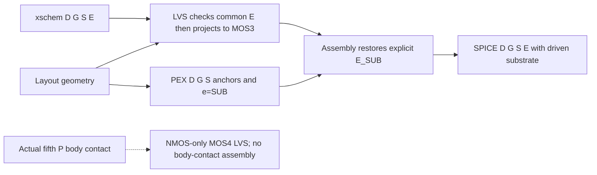

# ICPS2023_5 depletion-mode audit

_Scope: frozen PD reference, uncalibrated SOIMOD sensitivities, and the D/G/S/E endpoint chain. No nominal model promotion; no stdcell or CI changes._

## Decision and evidence hierarchy

Keep both existing `SOIMOD=0` cards byte-for-byte as the **PD reference**, not as evidence that either polarity is physically PD. Investigate unified `SOIMOD=1` first; use ideal-FD `SOIMOD=2` only as a limiting control. Neither is an FD model migration or a silicon-qualified replacement. NMOS and PMOS depletion assignments remain independently unresolved.

| Evidence | What it establishes | What it does not establish |
|---|---|---|
| Local PDK PDF p.7, pp.10–11 and the frozen 459 graph samples | One-geometry, 25 °C I–V targets and the documented effective fit | Net channel doping, body topology, back-gate response, C–V, or FD/PD of either polarity |
| `AIST-SOI-CMOS.xs` v0.2, dated July 2021 | A cross-section drawing prior with TSI=95 nm, TBOX=400 nm, TOX=15 nm | A measured or qualified complete ICPS2023_5 production stack |
| AIST/JAXA Technology 2018 announcement | Historical SOI CMOS/two-Al-layer IC demonstration | This revision's stack, polarity-specific depletion, body contacts, or compact-model parameters[^tech] |
| 2022 Minimal Fab FD/PD comparison | FD/PD **NMOS samples** differ in channel conductivity; reported FD samples respond to substrate bias while PD samples retain a screening neutral region | A PMOS conclusion or an assignment of those samples to this revision[^paper] |
| SMeRL design notes | Independent design context describing ordinary FD devices without B and optional special body structures | Foundry qualification or a complete body-contact extraction contract[^tips] |
| SMeRL full-custom tutorial | Its B=S suggestion concerns reuse of **bulk BSIM3v3**, explicitly with the author's uncertainty | Permission to wire BSIMSOI E to source[^tutorial] |
| BSIMSOI v4.4 manual | D/G/S/E/P definitions, selector equations, and required FD inputs | Measured process values for any inherited defaults[^manual] |

Technology names, publication dates, successful simulation, and I–V residual ranking are not physical depletion criteria.

## Physical criterion: two independent devices

A depletion approximation for a uniformly doped film gives

\[
W_d \simeq \sqrt{\frac{2\epsilon_{Si}|\psi|}{q|N_D-N_A|}}.
\]

This is a conditional electrostatic estimate, not an extraction from the local I–V fit. At specified front/back interface potentials, full depletion requires that depletion regions span the film without a neutral body region; the front-only estimate can be insufficient when the back interface also depletes. Accumulation, compensation/profile, work functions, BOX charge, temperature and contacts change that assessment. Thus film thickness alone cannot assign FD/PD.[^manual]

| Required physical input | NMOS status | PMOS status |
|---|---|---|
| Revision/lot-specific silicon film and BOX thickness | Not measured here; 95/400 nm are drawing priors | Same drawing prior, not an independent measurement |
| Net active channel doping, sign, compensation and depth profile | Unknown; simulator NCH is not a measured net doping | Independently unknown; do not copy an NMOS assignment |
| Back-gate/substrate doping, contact location, work function and bias | Unqualified | Unqualified |
| Ordinary body connectivity versus actual body-contact structure | Four-terminal model contract; physical details incomplete | Four-terminal model contract; physical details incomplete |
| Controlled substrate/body-bias I–V and C–V | Missing | Missing |
| Manufacturer-approved E/S/body reliability domain | Missing | Missing |

An isolated NMOS body-tie layout does not establish ordinary PMOS body topology. `K1`/`K2` fitted or fixed from zero-body-bias I–V do not uniquely recover net channel doping.

## Candidate construction and missing migration inputs

`tools/b4soi_depletion.py` generates 18 explicitly selected, self-contained libraries: two bases (frozen / existing overlap candidate) × three NMOS modes × three PMOS modes. Static single-device scans use six diagonal libraries to avoid repeated identical N/P measurements; inverter scans include all nine independent overlap N/P pairs and the three frozen diagonal references.

| SOIMOD | Role | Qualification boundary |
|---:|---|---|
| 0 | Frozen PD reference, or the existing charge-only overlap reference | I–V compatibility only; not proof of physical PD |
| 1 | Unified PD/FD sensitivity; preferred investigation path | No FD-specific calibration or process assignment |
| 2 | Ideal-FD limiting sensitivity | Idealized body treatment; no physical body-charge qualification |
| 3 | Not generated or selected | No automatic mode decision from unqualified parameters |

The only numeric **card-input** change from each base is `SOIMOD`. No manual default is forced into the card, no fifth P contact is inserted into ordinary benches, and no generated library is included by `icps2023_5.lib.spice`. The overlap base preserves only the existing CGSO/CGDO additions (N: 5e-9 F/m per side; P: 6.8e-9 F/m per side). This does not guarantee unchanged effective simulator parameters: mode 2 triggers the NCH adjustment below.

FD migration remains incomplete. Inventory includes NCH/NSUB/NGATE, TOX/TOXM/TSI/TBOX/XJ, VBSA, NOFFFD/VOFFFD, K1B/K2B/DK2B, DVBD0/DVBD1, MOINFD, VBS0PD/VBS0FD, and back-gate flatband VFBb/work-function assumptions. Derived or unexposed values are not silently filled. FDMOD is observed as 0; the newer FDMOD=1/CDSBS/VSCE formulation is not enabled, and its LPE0 and related dependencies remain uncalibrated.[^manual]

Actual ngspice-47 `showmod` exposes, for both polarities in modes 0/1, NCH=1.7e17 cm⁻³, NSUB=6e16 cm⁻³, NGATE=0, K1B=1, K2B=DK2B=DVBD0=DVBD1=0, MOINFD=1000, VBSA=VOFFFD=0, NOFFFD=1, VBS0PD=0 V, VBS0FD=0.5 V, and LPE0=1.74e-7 m. Mode 2 warns that NCH=1.7e17 with TSI=95 nm exceeds its maximum allowed band bending `(Eg−0.1)eV`; ngspice automatically resets NCH, and both N/P model queries expose **1.46152e17 cm⁻³**. Thus mode 2 is not a fixed-NCH selector-isolation experiment. Defaults and simulator-adjusted values are **not measured ICPS2023_5 physical values**. VFBB/VFBZB are not exposed by the retained model query.

Protected inputs remain unchanged:

| Input | SHA-256 |
|---|---|
| Frozen model card | `52d3111cf8e0b21633ae9378659518f00493a675212e9d17fff35593d75eb7d3` |
| Frozen fit manifest | `ef185519c09c9b7e595274f014edf0769671ae59f041c308c7c1550bf9d037e4` |
| Existing overlap model card | `1cbc670b5c11d9c9726bb1ef28fabc9074a751e6c8aa94a6db50af63b41b2dd9` |
| Digitized I–V CSV | `a2e13f591495705c49785f27471e85e44b602a701fcb79a8eaa01f72ad9876bd` |

## Endpoint chain



| Boundary | Current implementation and limit |
|---|---|
| xschem | Ordinary symbols emit D/G/S/E in order. The structural validator checked 45 symbols; no xschem GUI/netlisting session was exercised. |
| LVS | Requires a declared common `.GLOBAL SUB` E before projecting E out for ordinary MOS3 matching. It is not extracting the substrate/BOX physical structure. |
| Optional P | Direct simulator syntax accepts fifth P; physical LVS only maps NMOS4↔NCH4. No PMOS4/PCH4 extraction path exists. |
| PEX | MOS_MAP binds D/G/S geometry and declares `e=SUB`; SUB is a separate final return. Diffusion capacitance returned to SUB remains an explicit extraction assumption, not a measured BOX return. |
| Assembly | Accepts ordinary NMOS/PMOS. The source-tied MOS4 fourth node in serialized LVS output is an extraction artifact, not E or a real body tie. Every emitted MOS uses the separate E_SUB formal; body-contact classes are not assembled. |
| Simulation | New physical-style benches drive one explicit common substrate source and use four nodes. Fifth-P cases are separate syntax diagnostics only. |

The native W/L=24/6 µm inverter/NAND DRC→LVS→PEX→assembly→ngspice regression passed, including pre/post-layout logic, delay and current checks. Three additional LVS cases rejected a wrong E net, heterogeneous E nets, and a missing global E declaration. These are endpoint/regression checks, not process qualification.

Historical diagnostics are not the same topology: `diagnose_b4soi_transient.inv_deck` emitted five PMOS nodes in its `body=e` case and used E=VDD; `audit_b4soi_switching.inverter_deck` also used PMOS E=VDD. Some older T7 decks in `diagnose_b4soi_cv_leads.py`/`diagnose_b4soi_feasibility.py` left SUB undriven. Their reports remain historical records, not evidence for the corrected common-E benches.

## F0–F2: observed static evidence

All candidates use W/L=24/6 µm and TEMP=TNOM=25 °C. AC is at 1 kHz. The shared runner removes stale expected output, checks simulator return/logs, finite data, monotone sweep/time axes and requested endpoints, and retains every deck/log/data file. No new-audit convergence ladder or silent fallback is applied.

| Evidence | Observed | Failed | Inconclusive |
|---|---:|---:|---:|
| F0 finite model-load operating points | 12 | 0 | 0 |
| F0 full `showmod` introspection | 0 | 12 | 0 |
| F0 optional-P syntax-only operating points | 12 | 0 | 0 |
| F1 individual I–V curves | 72 | 0 | 0 |
| F1 mode-0 per-curve baseline checks | 24 | 0 | 0 |
| F1 mode-0 frozen/overlap sampled-current parity | 12 | 0 | 0 |
| F2 signed 4×4 AC matrices | 108 | 0 | 0 |
| F2 actual D/S-voltage exchange comparisons | 48 | 0 | 0 |
| F2 fixed-attempt gate ramps | 21 | 3 | 0 |
| F2 matching dQg/dV versus AC Cgg | 21 | 0 | 3 |
| F2 100 fF integration-sign calibration | 1 | 0 | 0 |

`observed` means a finite, complete numerical observation, not a calibration PASS. Full model queries return `<<NAN, error = 7>>` for XJ and several getter fields. They remain recorded failures separate from finite OP loading. Source XJ=50 nm is explicit and finite; the query result does not establish an invalid physical XJ or prove that this getter failure caused any transient problem. Requested SOIMOD and inherited FDMOD=0 are exposed for every N/P candidate.

F1 reproduces all 12 reference curves on each of six libraries. The overlap terms leave mode-0 currents unchanged. Unified mode 1 gives only small I–V changes from the existing fit. Ideal-FD mode 2 increases the transfer-curve errors; this is not a reason to choose PD or reject physical FD without re-fitting.

| Transfer RMS log10 current error (decades) | Mode 0 | Mode 1 | Mode 2 |
|---|---:|---:|---:|
| NMOS, \|VDS\|=0.05 V | 0.252157 | 0.253736 | 0.445563 |
| NMOS, \|VDS\|=1 V | 0.407210 | 0.411379 | 0.725480 |
| PMOS, \|VDS\|=0.05 V | 0.735506 | 0.742684 | 1.215109 |
| PMOS, \|VDS\|=1 V | 0.884624 | 0.891911 | 1.364613 |

F2 uses signed `I_into_device=-I(voltage_source)` and `Cij=Im(Yij)/(2πf)`, not elementwise absolute values. It includes off bias, common-gate ±0.2 V drain biases, strong inversion, and actual exchange of applied D/S voltages followed by the D/S row/column permutation. Reciprocity and same-VGS ±VDS equality are not assumed. The worst normalized D/S matrix difference is 1.6335%; the largest absolute row/column capacitance-sum residual is 1.839 fF. These are quantitative observations with unqualified model assumptions, not a root-cause diagnosis.

Gate ramps integrate raw G/D/S/E branch currents. Qd/Qs at nonzero VDS contain conduction; they are not individually displacement-only charges. The 100 fF 0→1 V calibration gives +99.999 fC under the current-into-device convention. The worst observed integrated four-terminal KCL residual is 1.95e-22 C. The worst observed endpoint dQg/dV versus same-bias AC Cgg difference is 7.21%, using `|difference|/max(|slope|,|Cgg|)`.

Retained fixed-ramp failures (no retry or altered parameters):

| Base / mode | Device | VDS | Recorded result |
|---|---|---:|---|
| Frozen / 0 | PMOS | −3 V | timestep too small near 0.966 ms |
| Frozen / 1 | NMOS | +3 V | timestep too small near 0.347 ms |
| Overlap / 0 | NMOS | +3 V | timestep too small near 0.811 ms |

The corresponding three derivative checks are inconclusive, not zero or PASS. The older overlap R1/R2/R3 verifier still passes its narrower reference checks; its ramp retry ladder and options differ, so that result does not erase the new fixed-attempt failures or justify nominal promotion.

## F3: transient and numerical sensitivity

The two bases use the same T7 pulse and inverter stimulus: 100 ns delay, 2 ns edges, 400 ns width, 1 µs period/stop, with the return edge included. Each case runs once with trap/20 ps, trap/10 ps, and gear/20 ps maximum steps. T7 uses normal OP with `.ic` (not UIC), the appropriate N/P off-state initial output, and 5 fF / 457 fF / 1 pF loads. Inverters use 5 fF, representative lumped 457 fF, or a **real FO1 second inverter gate pair**. All E terminals share a driven 0 V substrate; no fifth P is inserted.

| Transient evidence | Observed | Failed | Inconclusive |
|---|---:|---:|---:|
| Separate N/P T7 switches | 102 | 6 | 0 |
| Inverters, including true FO1 and mixed overlap N/P modes | 93 | 15 | 0 |
| T7 integrator/max-step comparisons | 66 | 0 | 6 unavailable comparisons |
| Inverter integrator/max-step comparisons | 57 | 0 | 15 unavailable comparisons |

The 21 failed runs are actual `timestep too small` aborts: 4 trap/20 ps, 6 trap/10 ps, and 11 gear/20 ps. They remain failed, without alternate-method rescue. Smaller maximum steps and gear are not uniformly successful. All six T7 aborts are in the frozen base: NMOS mode 1 once, PMOS mode 0 once, and PMOS mode 1 four times. Both bases' mode-2 T7 runs complete, but that does not qualify their charge behavior.

For frozen true-FO1 inverters, mode pairs 0/0 and 1/1 each complete 2/3 runs and abort with gear/20 ps; 2/2 completes 3/3. The independent overlap FO1 matrix is:

| Completed runs / 3 numerical settings | PMOS 0 | PMOS 1 | PMOS 2 |
|---|---:|---:|---:|
| NMOS 0 | 2/3 | 2/3 | 3/3 |
| NMOS 1 | 2/3 | 3/3 | 3/3 |
| NMOS 2 | 2/3 | 1/3 | 3/3 |

Full-run extrema and tail statistics answer different questions:

- Observed T7 output extrema span **−9.46155 to +7.97553 V** despite the 0/3 V supplies. Both extremes occur in frozen ideal-FD mode 2, 5 fF, trap/10 ps (PMOS minimum / NMOS maximum). This is a limiting-model/bench observation, not a silicon waveform or an approved voltage range.
- Observed inverter output extrema span **−1.33928 to +4.39619 V**. The worst observed inverter final-100-ns output RMS about its mean is only 4.65297e-14 V. A quiet final output does not erase switching excursions, failed runs, or unqualified current predictions.
- Tail values are linearly interpolated onto a uniform 5 ps grid over 900–1000 ns. T7's worst tail output RMS is 3.96347 mV, with 13.7584 mV peak-to-peak; these statistics can include drift and do not establish sustained oscillation.
- Among comparable completed runs, the largest absolute final-output change from trap/20 ps is 189.198 µV for T7 and 1.292e-10 V for inverters. These comparisons exclude unavailable runs; they are not a global convergence or physical-accuracy certificate.
- Settling is finite-window settling within 60 mV of the **last observed output**, referenced to the last gate/input edge. It is not a guarantee of the correct logic rail, asymptotic stability, or physical leakage. The interpolated input at the first falling output=1.5 V crossing is a switching observable, not a DC trip point.
- Quiet output also hides current chatter: frozen 0/0, 5 fF, trap/20 ps has a tail supply-branch RMS of 2.61692 mA and 8.56753 mA peak-to-peak, with 5,001 zero crossings. Its last supply-current sample is −4.56598 mA while its output is approximately 3 V. These alternating source-branch samples are not a valid static-leakage estimate or proof of a physical oscillator.

F3 currents retain voltage-source branch signs: T7 `i(VDSENSE)` is OUT→DRAIN; inverter `i(VPWR)` is VDD→0 and `i(VIN)` IN→0. F2's current-into-device convention must not be copied onto these fields. No mode or overlap pair is selected because its output is quiet.

## F4: offline substrate response, not a hardware discriminator

All 72 transfer sweeps completed and all 24 constant-current sensitivities have one bracketed crossing. Source is 0 V; E is −0.1/0/+0.1 V. NMOS uses VG=0→3 V and VDS=+0.05/+1 V; PMOS uses VG=−3→0 V and VDS=−0.05/−1 V. The 10 mV gate grid is linearly interpolated at abs(ID)=1 µA. The central finite difference is `[VGS(E=+0.1)-VGS(E=−0.1)]/0.2 V`.

| Device / mode | dVGS/dE at abs(VDS)=0.05 V (V/V) | dVGS/dE at abs(VDS)=1 V (V/V) |
|---|---:|---:|
| NMOS / 0 | 0 | 0 |
| NMOS / 1 | −8.90845e-7 | −7.41564e-7 |
| NMOS / 2 | −0.00401327 | −0.00392090 |
| PMOS / 0 | 0 | 0 |
| PMOS / 1 | −8.91588e-7 | −8.35304e-7 |
| PMOS / 2 | −0.00405051 | −0.00421877 |

Frozen and overlap bases give identical extracted sensitivities in this experiment. The near-zero unified numbers are numerical observations at this interpolation grid and solver tolerance, not independently resolution-qualified back-gate coefficients. The difference from the ideal-FD control describes inherited model equations/defaults, not the depletion mode of ICPS2023_5 silicon.

The first F4 execution exposed a harness defect: the PMOS −3→0 V sweep ended at −1.9675e-14 V after all 301 points, but an absolute-stop tolerance falsely rejected it. Endpoint tolerance now scales with sweep span. A boundary regression failed before and passed after the correction, while a genuinely missing 10 mV endpoint remains rejected. All 72 F4 decks were re-executed unchanged; original false-rejection evidence is retained separately. The 216 F3 results are retained: their zero-starting time axes use the same endpoint tolerance before and after this correction. No model, bias or numerical option was tuned to obtain completion.

Phase-3 review also found an extraction edge case: skipping a sample exactly at the current reference could move its root or turn an equality interval into a unique threshold. Exact samples are now preserved; intervals and multiple roots are inconclusive. Boundary regressions cover signed/endpoint roots and nonunique cases. Reprocessing all 195 completed transient traces changed no recorded metric, and re-executing all 72 F4 decks changed no sensitivity; the present F4 datasets have no sample exactly equal to 1 µA. Both phase-3 reviewers approved after this correction.

## Qualification blockers and next measurements

**F4 hardware discrimination is blocked** until the manufacturer supplies an approved E/S/body operating and reliability domain. Any offline substrate sweep in this audit is mathematical sensitivity only, not a safe-bias recommendation.

**F5 fitting and silicon validation are blocked** by missing:

1. Exact wafer/process revision and lot, per-polarity film/BOX stack and active net channel-doping sign/profile/compensation.
2. Substrate/back-gate doping, work function/flatband/BOX charge, electrical contact/access structure, and ordinary/special body-contact topology.
3. Polarity-resolved ID–VG/ID–VD at controlled E/body bias and temperature, with geometry and current conventions recorded.
4. Front/back-gate C–V or charge measurements, including relevant bias and frequency ranges; body-contact data only for physically present contacts.
5. Manufacturer-approved G/D/S/E/P limits over temperature and duration, plus silicon transients/loads for dynamic validation.

Use those inputs to test the NMOS and PMOS depletion hypotheses separately and calibrate the unified/FD equations and charge behavior. A quieter transient or a lower zero-body-bias I–V residual is insufficient.

## Reproduction and retained evidence

```sh
python3 libs.tech/ngspice/tools/audit_b4soi_depletion_static.py \
  --ngspice /path/to/ngspice --out build/ngspice-depletion --timeout 30
python3 libs.tech/ngspice/tools/audit_b4soi_depletion_dynamic.py \
  --ngspice /path/to/ngspice --out build/ngspice-depletion --timeout 30
python3 libs.tech/ngspice/tools/test_b4soi_depletion.py
python3 libs.tech/ngspice/tools/test_b4soi_stage1_iv.py
python3 libs.tech/ngspice/tools/verify_overlap_candidate.py
ruby libs.tech/xschem/tools/validate_symbols.rb
```

The audit command exit code describes evidence collection, not all-case PASS. The versioned [machine-readable snapshot](b4soi_depletion_mode.json) records protected hashes, candidate deltas, counts, per-case metrics and unresolved gates. Full JSON/Markdown summaries and candidate manifests are under the explicit output directory; raw decks/logs/wrdata remain in `static/` and `dynamic/`. `harness_endpoint_roundoff.json` retains the original F4 false rejections. New evidence-runner/extraction regressions passed 8/8; frozen stage-1 tests passed 3/3. The executed simulator was `/opt/homebrew/bin/ngspice` 47; native integration used KLayout 0.30.7/Python 3.13.9 from the pinned Nix shell and ngspice 47. No stdcell test or CI was run.

## Sources

[^paper]: Hamamoto et al., *Comparison of Fully-Depleted(FD) and Partially-Depleted(PD) Operation of SOI CMOS of Minimal Fab*, JSAP autumn 2022, session 20p-A406-12. [DOI](https://doi.org/10.11470/jsapmeeting.2022.2.0_2726), [article](https://www.jstage.jst.go.jp/article/jsapmeeting/2022.2/0/2022.2_2726/_article/-char/ja/), [original PDF](https://www.jstage.jst.go.jp/article/jsapmeeting/2022.2/0/2022.2_2726/_pdf/-char/en).
[^tech]: AIST/JAXA, 2019-05-10, [Technology 2018 SOI CMOS demonstration](https://global.jaxa.jp/press/2019/05/20190510a.html).
[^tips]: SMeRL, 2026-02-16, [Minimal Fab design tips](https://smerl.jp/minimal-dt/); independent design commentary, not a foundry specification.
[^tutorial]: SMeRL, 2025-07-31, [Full-custom tutorial](https://smerl.jp/minimal-fc/); explicitly uncertain legacy bulk-model B=S suggestion.
[^manual]: Berkeley BSIMSOI v4.4, [official user manual](https://ngspice.sourceforge.io/external-documents/models/BSIMSOIv4.4_UsersManual.pdf) and [Berkeley model/release page](https://www.bsim.berkeley.edu/models/bsimsoi/). Model equations and defaults are not silicon measurements.
